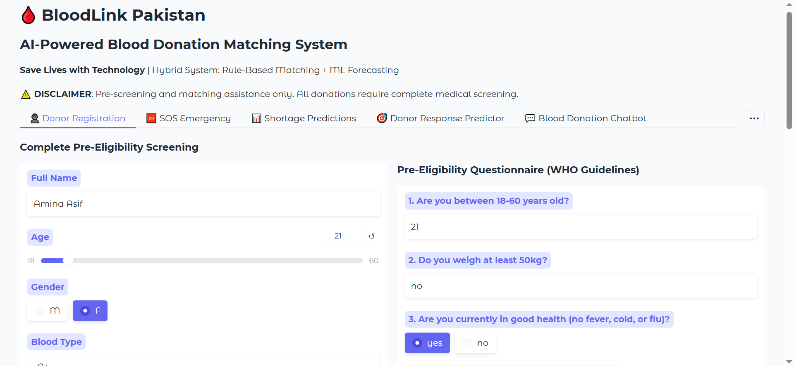
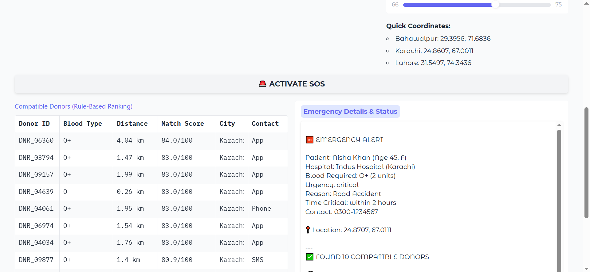
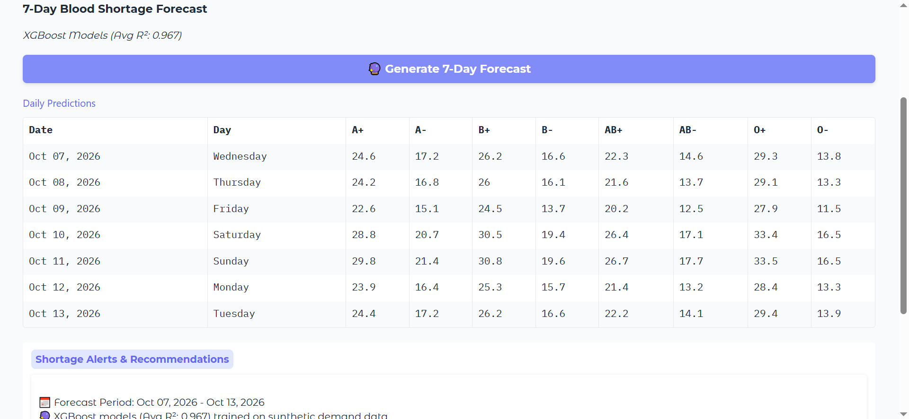
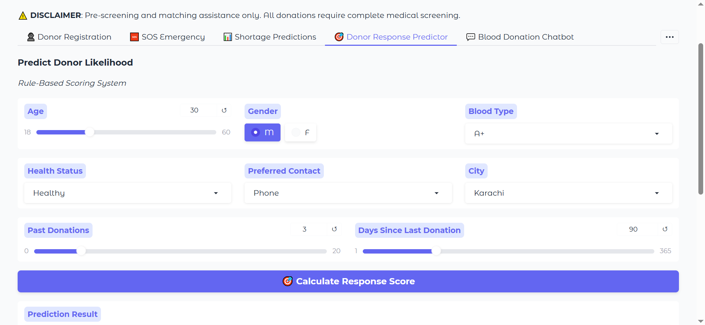
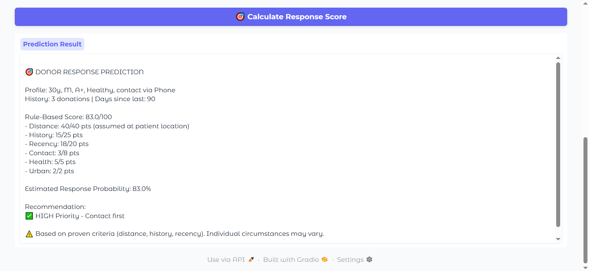
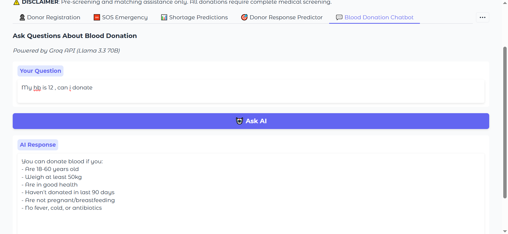

# Bloodlink-Pakistan

**A rule-based donor-matching, XGBoost shortage-forecasting and chatbot prototype for blood donation, built on synthetic data**

[](LICENSE)
[](https://www.python.org/)
[](https://www.gradio.app/)

Gradio web app that ranks nearby compatible blood donors for an emergency request, forecasts 7-day blood demand per blood type with XGBoost, pre-screens donor eligibility, and answers donation questions with a Groq-hosted Llama 3.3 chatbot, **together with an honest account of what its reported numbers do and do not mean**.

> **Please read this first.** Every dataset in this project is **synthetic**: the 10,000 donors, the 12,000 daily demand records, the emergency patients and the hospital stock levels were all generated by code. The reported "response rate" and forecast R² therefore measure how well the system recovers rules that the generator itself used, not how it would perform with real donors or hospitals. It is a demonstration of the design, not a validated system.

---

## Contents

1. [Repository layout](#repository-layout)
2. [What the project does](#what-the-project-does)
3. [Screenshots](#screenshots)
4. [Main results and how to read them](#main-results-and-how-to-read-them)
5. [How the matching score works](#how-the-matching-score-works)
6. [Run it locally](#run-it-locally)
7. [Deploy](#deploy)
8. [Data](#data)
9. [Limitations](#limitations)
10. [Future work](#future-work)
11. [Authors and credits](#authors-and-credits)
12. [Licence](#licence)
13. [Disclaimer](#disclaimer)

---

## Repository layout

```
Bloodlink-Pakistan/
├── README.md                      this file
├── LICENSE                        MIT licence
├── app.py                         the complete Gradio app (data generation, models, UI)
├── requirements.txt               Gradio 5.50.0 plus the other Python dependencies
├── BLOODLINK_clean.ipynb          original Colab notebook
├── BloodLink_Presentation.pptx    course presentation (Deep Learning, 29 Dec 2025)
├── Artifacts/                     saved output of one run: generated data, trained models, metrics
└── Screenshots/                   app screenshots used in this README
```

| Folder | Contents |
|--------|----------|
| [`Artifacts`](Artifacts/) | `donor_database.csv` (10,000 synthetic donors), `shortage_history.csv` (12,000 daily demand records), `shortage_model_<type>.json` (one trained XGBoost model per blood type: A+, A-, B+, B-, AB+, AB-, O+, O-), `metrics.json` (the scores of that run) |
| [`Screenshots`](Screenshots/) | six screenshots of the app (registration, SOS, forecast, response predictor input and result, chatbot) |

`git.keep` in each folder is an empty placeholder file.

**How the app uses these files:** `app.py` does **not** read the `Artifacts/` folder. Every time it starts, it generates the synthetic data again, trains the eight XGBoost models and runs a quick validation, so start-up takes a little while. Because all seeds are fixed at 42, each start produces the same data as the saved files. The `Artifacts/` folder is there so you can look at the data and models without running the app.

---

## What the project does

The app has eight tabs:

- **Donor Registration.** Registers a donor (name, age, gender, blood type, city, weight) and runs the eligibility questionnaire.
- **SOS Emergency (donor matching).** Given a blood type and a location, the app keeps donors with a compatible blood type within 25 km and ranks them with a transparent six-rule score. Emergency mode weights distance more heavily.
- **Shortage Predictions.** One XGBoost regressor per blood type predicts daily demand for the next 7 days from calendar features (day of week, month, weekend, day of year), three lag values and a 7-day rolling mean, and flags days predicted below 5 units.
- **Donor Response Predictor.** Shows the score breakdown for a donor profile and converts it to a rough priority level.
- **Blood Donation Chatbot.** Answers donation questions (eligibility, frequency, Ramadan, halal status, process) with Llama 3.3 70B (`llama-3.3-70b-versatile`) through the Groq API. Without an API key it falls back to a keyword-based answer set.
- **Gamification & Rewards.** Points and badges per donor (First Drop, LifeSaver, Hero) and a leaderboard that can be filtered by city.
- **Hospital Inventory.** An editable stock table for five hospitals.
- **About & Disclaimers.** The performance numbers of the current run and the medical disclaimer.

The **pre-eligibility questionnaire** has nine WHO-style questions: age 18-60, weight at least 50 kg, current health, donation in the last 90 days, chronic conditions, current medicines, tattoos or piercings in the last 6 months, travel to malaria-risk areas in the last 3 months, and haemoglobin level (at least 12 g/dL). It gives an eligibility result and a score. It is pre-screening only.

---

## Screenshots

**Donor registration**



**SOS emergency matching**



**7-day shortage forecast**



**Donor response predictor (input and result)**





**Chatbot**



---

## Main results and how to read them

The numbers below come from `Artifacts/metrics.json` (the saved run) and from the notebook.

| # | Result | How to read it |
|---|--------|----------------|
| 1 | Simulated donor response rate **about 76%** (76.0% in the saved run of 200 simulated emergencies, top 10 donors each; 76.2% in the notebook run of 500). The top-ranked donor responded in 82.5% of cases. | The "true" response probability is generated from the same ingredients the score uses (recency, history, contact method, health), so the score is partly recovering its own generator. Treat it as a sanity check, not as real-world accuracy. |
| 2 | Shortage forecast: mean **R² 0.968** (0.964 in the notebook), **MAE about 0.95** requests/day (chronological 80/20 split, per blood type) | The demand series was built from a formula (base level, blood-type offset, weekend, seasonal and weekly cycles, Ramadan bump, small noise). A high R² shows the model learns that formula, not that real demand is this predictable. |
| 3 | Matching is fully explainable | Each recommendation comes with a point breakdown per rule; no black-box model is involved in ranking. |
| 4 | Average distance to contacted donors **about 2.2 km** | Donors are placed within about 9 km of seven city centres, and the simulated patients are near those centres, so distances are short by construction. |

The numbers shown in the About tab of the app are computed again at every start-up.

**What we do not claim:** that this system has been tested with real donors, blood banks or hospitals; that the forecast reflects real Pakistani blood demand; that the eligibility questionnaire replaces medical screening; or anything about the chatbot beyond the fact that it is a general-purpose language model given a short safety-oriented prompt.

---

## How the matching score works

| Rule | Points | Based on |
|------|--------|----------|
| Distance | 0-40 | straight-line distance to the patient (under 2 km: 40, under 5 km: 35, under 10 km: 25, under 15 km: 15) |
| Donation history | 5-25 | number of past donations (10 or more scores highest) |
| Recency | 5-20 | days since last donation |
| Contact method | 3-8 | App (8) > SMS (5) > Phone (3) |
| Health status | 0-5 | Healthy (5) / Minor issues (3) / Unhealthy (0) |
| Urban bonus | 0-2 | donor lives in Karachi, Lahore, Islamabad or Faisalabad |

In emergency mode the final score is **0.7 x total + 0.5 x distance points**. Blood-type compatibility uses the standard donor-to-recipient matrix.

---

## Run it locally

```bash
git clone https://github.com/Kasa-e-Fatima/Bloodlink-Pakistan.git
cd Bloodlink-Pakistan
pip install -r requirements.txt
python app.py
```

Open the local address printed in the terminal (by default http://localhost:7860).

To enable the Groq chatbot, set an environment variable **before** starting. Never put the key in the code or the repository.

```bash
# Windows (Command Prompt)
set GROQ_API_KEY=your_key_here

# Linux / macOS
export GROQ_API_KEY=your_key_here
```

Without a key, the chatbot still works in fallback mode with fixed answers.

---

## Deploy

Any host that runs a Python web process works (for example a free container host such as SnapDeploy).

1. Push this repository to GitHub. (The `Artifacts/` folder is not needed by the app.)
2. Create a web service from the repository. Build: `pip install -r requirements.txt`. Start: `python app.py`.
3. Set the environment variable `GROQ_API_KEY` (your key) in the host's dashboard. The app reads the port from `PORT` (default 7860) and listens on `0.0.0.0`.

Free instances usually sleep after some idle time, so the first request after a pause can take a minute or more, and the app also has to regenerate data and retrain the models when it wakes up.

---

## Data

All data are generated by `app.py`; nothing is downloaded and no personal information is used. A saved copy of the generated data is in `Artifacts/`.

| Table | Size | Contents |
|-------|------|----------|
| Donors | 10,000 | blood type (skewed towards O+, B+, A+), age, gender, city and coordinates, donation history, days since last donation, contact method, health status, simulated response probability |
| Daily demand | 12,000 | 1,500 days x 8 blood types, ending 31 Dec 2025 |
| Emergency patients | 2 | hand-written examples (Karachi, Lahore) |
| Hospital inventory | 5 hospitals | hand-written stock levels (Karachi x2, Lahore, Islamabad, Bahawalpur), editable in the app |

Donors are placed in seven cities: Karachi, Lahore, Islamabad, Quetta, Peshawar, Multan and Faisalabad.

---

## Limitations

- Entirely synthetic data.
- Donors exist only in seven cities. Bahawalpur appears in the hospital list but has no generated donors, so a Bahawalpur-centred SOS search finds nobody.
- Straight-line distances rather than road travel time.
- Scoring weights chosen by hand and not tuned or validated against real responses.
- One forecasting model family and no uncertainty intervals. For all 7 forecast days, the lag features are kept at the last observed values rather than updated day by day.
- Inventory and gamification are held in memory and reset when the app restarts.
- No user accounts, consent flow or privacy controls, which a real donor registry would need.

---

## Future work

| Phase | Plan |
|-------|------|
| 1 (about 3 months) | Backend integration (PostgreSQL, REST APIs) so donors, inventory and points persist |
| 2 (about 6 months) | Real pilot with 2-3 hospitals and an SMS gateway, the first step that can test whether prioritised contact actually raises donor response |
| 3 (about 12 months) | Mobile app and Urdu interface |
| 4 (18+ months) | Wider expansion with institutional partners |

These are plans, not completed work.

---

## Authors and credits

**Amina Asif** and **Kasa-e-Fatima**, Department of Artificial Intelligence, The Islamia University of Bahawalpur, Bahawalpur, Pakistan.

Course project for **Deep Learning**, supervised by **Prof. Dr. Ghulam Gilanie** (presented 29 December 2025).

Built with Gradio, XGBoost, scikit-learn, pandas, NumPy, GeoPy and the Groq API.

---

## Licence

The code in this repository is released under the [MIT Licence](LICENSE).

---

## Disclaimer

This is research code and an academic prototype built on synthetic data. It is **not a medical device** and **not validated** for real blood-donor matching, emergency response or hospital planning. All donations require complete medical screening at certified centres, and nothing in this app or its chatbot is medical advice.
